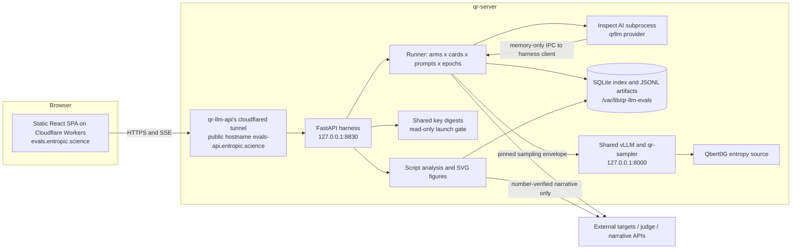

# Research harness design

This is the repository-facing design summary of approved spec v1 (2026-09-14),
D-1 through D-14, and of D-15 and D-16 (November 2026), which were decided
after that spec and are recorded only here. The binding task inputs remain
`.\.zenflow\tasks\plz-follow-the-following-workflo-a741\requirements.md` and
`.\.zenflow\tasks\plz-follow-the-following-workflo-a741\spec.md`.
Those task artifacts are local, not required at runtime. This tracked document preserves their system
shape and decisions; detailed API, analysis, and operator contracts live in
`.\docs\API.md`, `.\docs\ANALYSIS_PLAN.md`, and `.\docs\SETUP_GUIDE.md`.

## System shape

The browser configures, observes, and controls; the backend owns all generation
and persists progress independently of viewers. Thin and Inspect tasks share
one dispatch/provenance path. No vLLM/QRNG server is embedded in this package.
The harness calls the shared serving engine directly, not the public edge that
strips client sampling keys. External-provider arms are explicitly PRNG-only
comparisons and cannot promise the identical pinned local pipeline.

## Decision register

| Decision | Binding choice | Detail |
|---|---|---|
| D-1 | Shared vLLM on loopback `:8000` directly; edge keys gate launch only. | [Serving contract](#serving-contract) |
| D-2 | Python 3.11 FastAPI plus pnpm/TypeScript React SPA in one repository. | [Layering](#layering) |
| D-3 | Static frontend on Cloudflare Workers (assets only, no Worker script); a public hostname on qr-llm-api's cloudflared tunnel to loopback `:8830`. | [Deployment](#deployment) |
| D-4 | SQLite index plus append-only JSONL artifacts; no Postgres. | [Storage and secrets](#storage-and-secrets) |
| D-5 | Thin runner primary; custom Inspect `qrllm` provider for Inspect cards. | [Execution](#execution) |
| D-6 | Per-request derived seed `H(study_seed, card_id, prompt_id, epoch)`; study seeds 1, 7, 42. | [Equivalence](#equivalence-and-provenance) |
| D-7 | Identical stateless `zscore_mean`, calibration 0, prefetch off; creative sampling with top-p 0.95. | [Equivalence](#equivalence-and-provenance) |
| D-8 | Engine token-log Tier 0 when available; explicit degraded API-logprob path otherwise, T0-a unavailable. | [Dependencies](#serving-contract) |
| D-9 | Native Anthropic Messages judge with BYO key; OpenAI-compatible external targets via httpx, no OpenAI SDK. | [Execution](#execution) |
| D-10 | Script-generated matplotlib SVG figures and JSON tables, not LLM-generated numbers. | [Analysis](#preregistration-and-analysis) |
| D-11 | SHA-256 of exact UTF-8/LF prereg Markdown; embed canonical JSON config hash. | [Preregistration](#preregistration-and-analysis) |
| D-12 | Apache-2.0 code, CC BY-SA 4.0 docs/prereg/results prose, CC BY 4.0 raw data. | [Publication](#preregistration-and-analysis) |
| D-13 | Pseudonymous display name and random observer ID in localStorage; random host token. Observers have no accounts. People who launch runs do (amended November 2026): a username, a password and one linked api.entropic.science key, of which only the SHA-256 is stored. | [Supervision](#supervision) |
| D-14 | Run-scoped BYO keys only in process memory; restart requires key resupply. | [Secrets](#storage-and-secrets) |
| D-15 | A study with a `design` block is decided by a registered decision matrix. For such a study, exceeding the largest seed-pair difference is a reported flag (`above_seed_noise`), not a condition of a claim, and the negative-control gate is "no seed pair rejects after correction". This amends requirement FR-6.1 for designed studies only; a study without the block keeps the Study 1 plan and FR-6.1 unchanged. | [Designed studies](#designed-studies-d-15) |
| D-16 | The harness checks every reply, token record, score and judgement as a run stores it, by rules that no study can change. A flag marks a sample and excludes nothing; exclusions stay with the four kinds of taint. A check that stops a run pauses it with a stored reason, and only the host goes on from there. | [Result checks](#result-checks-d-16) |

## Layering

Imports point downward; `.\backend\tests\test_layering.py` is the executable
oracle. Composition roots wire adapters without upward package imports.

- **Layer 0**: config, client, keys, cards, models (restricted internal imports).
  The catalogue of the result checks, `cards/result_checks.py`, is here and
  imports nothing of the package, so every layer can use it.
- **Layer 1**: tier0, store, prereg. The health summary of a run,
  `store/health.py`, is here.
- **Layer 2**: runner, inspect_bridge, supervised; analysis has its separately
  constrained store/cards/tier0 boundary and leaf statistics functions.
- **Composition/API**: readiness, preflight, entrypoint, and API assemble the
  lower layers. No domain module imports API.

Never import `openai`, `vllm`, or `modal` anywhere under the backend. Heavy ML
libraries belong only under the lazily loaded analysis metrics area; they must
not download models or occupy serving GPUs during core startup. Package import
is side-effect free. Only `.\backend\src\qr_llm_evals\config.py` reads the
process environment, and every read has a row in `.\infra\ENV_REFERENCE.md`.

## Serving contract

The shared engine supplies chat completions, streaming, logprobs, request IDs,
per-card thinking flags, and entropy health. Qbert0G is consumed indirectly.
The key digest file belongs to qr-llm-api; group-readable access is an explicit
cross-repo operator step, with probe verification as a fallback. No raw key is
written into a run record.

**DEP-1** requests per-request token records joined by the harness request ID,
including post-truncation probability/rank, candidate count, entropy, sampled
uniform value, and CDF brackets. This export is qr-sampler work, not implemented
by harness deployment. Without usable records, raw API-logprob diagnostics are
labelled as such; T0-a and T4-l are unavailable. **DEP-2** requests epsilon-biased
seeded PRNG (`u' = u**(1+epsilon)`) as a positive control; unsupported arms stay
unavailable. Never substitute invented residuals or relabel an unsupported arm.

Readiness checks source health, envelope equivalence, solo/concurrent replay,
Tier-0 availability, epsilon support, and optionally throughput. An HTTP health
response proves neither experimental readiness nor deterministic replay.

## Equivalence and provenance

The harness owns `.\backend\src\qr_llm_evals\models\envelope.py`; browser-supplied
`qr_*` parameters are never forwarded. Study 1 compares QRNG supervised,
QRNG unsupervised, and three seeded PRNG arms, with the same model, prompts,
sampling, amplifier, and acquisition path. Derived per-request seeds prevent
restarting the same PRNG uniform stream for every prompt. The arms differ only
in entropy source, derived seed, and optional epsilon; exceptions are explicit
in cards and frozen in preregistration.

`quantum=true` requires the QRNG source and no fallback. A fallback taints a
sample; seeded, system, biased, and external provider PRNG are never labelled
quantum. Sample IDs connect generations, Tier-0 records, scoring, and resumption.
Determinism has measured tiers, not a binary promise; see `.\docs\determinism.md`.
An amplifier transform is not proof of quantum purity or observer influence.

## Execution

The runner schedules arms/cards/prompts/epochs under the global concurrency
budget, persists completed samples, and resumes without regenerating them.
Streaming feeds bounded subscriber queues; slow or absent viewers do not
change output generation. Inspect generation uses a subprocess and memory-only
IPC back to the same harness client; details in `.\docs\inspect-bridge.md`.

The registry source is `.\evals\`; `.\docs\evals.md` and generated contracts
under `.\packages\contracts\src\generated\` are machine-generated, never
hand-edited. Cards state datasets/revisions, sample counts, thinking, judge,
endpoints, estimates, and availability. Planned cards are not selectable.
Judges are fixed across arms and different from the target. External endpoints
use thin HTTP clients, never an SDK that can obscure request sampling control.

## Storage and secrets

SQLite indexes studies, runs, sessions, observers, progress, and taints; durable
JSONL and analysis artifacts live under `/var/lib/qr-llm-evals`. Release code is
separate. Data is quarantined or marked withdrawn, never deleted by deployment.
Backups must be transactionally consistent and retain artifact/index agreement.

The launch bearer key authorizes execution only. BYO target/judge/narrative keys
live in a run-scoped in-memory `SecretBag`, are filtered from logs/errors, and
are represented on disk only by presence booleans. Restart loses those keys;
`needs_keys` requires host resupply, not automatic reconstruction. Host tokens
are returned to hosts, stored hashed server-side, and not shared with observers.
See `.\docs\PRIVACY.md` for publication and consent limits.

## Supervision

Host authority controls every transition into `running`. The flow is briefing,
consent, intention (3 minutes by default), explicit Start, approximately
30-minute generation-bounded sessions, 10-minute break, 30-second refocus, and
explicit Resume. Timers may go negative and never initiate generation. Near a
session boundary, expected generation length decides whether to dispatch;
in-flight generations finish, even with modest overrun. Pseudonymous observers
join and complete pre/post questionnaires per session. Display is a viewer,
not part of sampling; breaks, presence, and intention are recorded as study data.

## Preregistration and analysis

Freeze the config, models, dataset hashes, arm envelopes, exclusions, stopping
rules, estimands, researcher expectations, and analysis plan before the full
run. Prereg Markdown uses exact UTF-8/LF bytes; canonical JSON uses sorted keys
and no non-finite values. Changing configuration makes the previous prereg stale.
Pilot data is separate; publication after a pilot is not retroactive preregistration.

Scripts implement the frozen analysis and emit tables/SVGs. The narrative model
may restate only numbers present in those tables; verification rejects invented
numbers. Multiplicity, equivalence margins, seed-vs-seed controls, positive
controls, and missing endpoints must remain visible; see `.\docs\ANALYSIS_PLAN.md`.
Results and their provenance are downloadable under the stated licences.
A null, tainted, or underpowered result must not be rewritten as a positive
consciousness claim; the empirical hypotheses do not establish metaphysics.

## Designed studies (D-15)

A study file may carry a `design` block: the outcomes that decide the study,
the claim, the significance level, the positive control and the margins. The
plan of such a study has one hypothesis per confirmatory outcome and compared
(model, sampling preset) pair, and a script resolves each to one verdict
under decision matrix version 1. The full contract is in
`.\docs\ANALYSIS_PLAN.md` ("Designed studies"). This section records the
decisions behind it.

**What D-15 amends.** Requirement FR-6.1 allows a claim of a quantum effect
only if the effect survives the Holm correction and its magnitude exceeds the
largest of the three seed-against-seed differences on the same statistic.
The built-in Study 1 plan still applies that rule. A designed study does not:
the quantum-against-control difference is taken against the mean of several
seeded runs, while each seed pair compares two single runs, so the two
magnitudes are not on one scale. A designed study may also have any number of
seeded runs from two upward, where the Study 1 rule names three. In a
designed study:

- The seed-against-seed comparisons are a **gate**, not a yardstick. The
  negative control of a hypothesis passes when every planned seed pair of its
  comparison was computed on the outcome and none rejects after Holm
  correction, in one family over every seed pair of every hypothesis. A
  failed or missing seed control makes the hypothesis `invalid`.
- A gate that cannot close is not a gate. A seed pair whose test ran too few
  permutations to return a p-value below the corrected level passes whatever
  the seeds do, and with too few prompts it is not certain that two seeds
  that differ would fail. Such a control does not count as a pass: the
  hypothesis is `invalid` with the reason `negative_control_cannot_fail`.
  For the same reason the number of permutations is the largest of three
  numbers: 10 000, 20 times the number of difference tests divided by α, and
  2 times the number of seed-pair tests divided by α. A design whose paired
  outcome plans fewer prompts than the control floor is reported by the
  setup page as a blocking problem before launch.
- Whether the estimate exceeds every seed-pair difference is still computed
  and written beside the verdict as `above_seed_noise`. It is reported and
  decides nothing.

**What does not change.** A study without a `design` block keeps the Study 1
plan, its claim rule, its bytes and its hashes
(`.\backend\tests\test_legacy_bytes.py`). The contrasts of a designed study
are those of the built-in plan; a design never changes which arms are
compared, and comparisons are never pooled.

**Decided with D-15.**

- **Only the first full run is confirmatory.** A pilot run and every full run
  after a study's first resolve their hypotheses, and every sentence then
  begins "Not confirmatory: ". The order of the full runs is recorded with
  each run at its first analysis (`run-order.json`).
- **Which runs count as earlier full runs.** Every run of the study that is
  not a pilot and was created before the run in question, whatever became of
  it: a failed, aborted or withdrawn full run has used up the confirmatory
  run. Two rules complete this. A full run that was launched and never
  started (its state is still `created`) generated nothing and does not
  count. And a full run that has already been analysed, and recorded its
  run order without the run in question, counts as earlier even if it was
  created later: it was analysed as a full run of the study while the other
  had produced nothing. Without the second rule a run that was passed over
  while unstarted, and started afterwards, would make two runs the first.
  The first rule reads the run's state, and a restart of the backend moves
  every unfinished run to `needs_keys` (or to `paused` when it held no
  provider key): an unstarted full run that is on
  the server across a restart counts from then on.
- **A study is registered once and takes further runs.** The first launch
  freezes the configuration, the pre-registration and, for a designed study,
  the plan. A later launch with the same configuration adds a run to that
  study and freezes nothing: a pilot is followed by the full run, an aborted
  run by another. The pre-registration prints the readiness report of the
  launch it was rendered for, so a document rendered for a later launch
  never has the bytes of the frozen one; the server therefore does not
  compare the two, and the registered document stays the first. Every run
  is recorded under the frozen document's hash.
- **Only its launcher adds runs to a designed study.** A study is identified
  by its configuration alone (its id is derived from the config hash), and a
  frozen configuration is public. Since only the first full run of a
  designed study is confirmatory, a run added by anybody else could use that
  run up or stand before it. A designed study therefore takes runs only from
  the launcher of the runs it has: the same account or, for runs launched
  with a bare launch key, the same key. Anybody else is refused with `409`
  and told how to register the design as a study of their own (another
  title or creation time gives another study id). A study without a design
  block has no confirmatory run to protect and takes runs from anybody, as
  before.
- **A designed study is judged by its registered plan or not at all.** The
  plan hash is printed in the frozen pre-registration. Before an analysis
  and before a further launch the server checks the archived plan against
  it. A plan file with another hash is refused. A missing file is rebuilt
  only if the current eval registry still gives exactly the registered
  plan; otherwise the server answers `409` and asks for the file to be
  restored from a bundle of the study.
- **A pilot runs the whole study.** It is the configured study under the
  label `pilot`. The harness does not subsample it, and a designed study
  derives nothing from it: margins are fixed at registration (the card's
  SESOI, or a declared margin where the card has none).
- **Conventions.** Power 0.80 for every rating and recommended sample size.
  A reference effect of 0.30 standard deviations for an outcome that has no
  margin in its own units. A declared margin of at most 10% and at least
  0.1% of the outcome's range. Completeness of at least 90% of the planned
  data for a verdict to stand. The constants are in
  `.\backend\src\qr_llm_evals\cards\power.py`. The power, the reference
  effect and the completeness threshold are printed in every designed
  pre-registration; the two margin limits are applied when the plan is
  built, and a declared margin outside them is refused.
- **The variance bound counts what is independent.** The sample-size ratings
  rest on the largest variance a bounded outcome can have. Every reply of a
  quantum arm draws fresh entropy and counts as one value. The told cells of
  a seeded run share one seed for each prompt and repetition, so on the
  control side they count as one value, not three. With that bound the
  experience-claim rate of Study 1 needs 24 repetitions, not the 20 of its
  card, for its 30 prompts to be rated sufficient, and the designed form of
  Study 1 runs it at 24.
- **Tainted samples decide nothing.** A sample marked as tainted never
  enters the clean analysis, also when every sample of an arm on an eval is
  tainted. The hypotheses that need that arm are then `unavailable`.
- **A draft is read by one route only.** The setup page saves a study as it
  stands, so a study file may break rules that span several fields. `POST
  /config/parse` reads such a file and lists what it breaks; every route
  that plans, renders, estimates or launches a study validates it in full.
- **The positive-control arm runs on its own seed.** The biased (ε) arm that
  a design names as its positive control (`sensitivity_epsilon`) must not
  share a seed with any seeded control arm of its comparison; a study file
  that breaks this is refused. A shared seed would give the biased arm and
  one control the same underlying draws, which overstates how well the assay
  detects the bias. The Study 1 files predate this rule and keep their ε arms
  on a seed that a control arm also uses; the designed form of Study 1
  (`.\packages\contracts\fixtures\study1.designed.json`) puts its ε arm on
  seed 1001.
- **The plan is frozen at launch.** A designed study's plan is archived as
  `prereg-plan.json` when the study is frozen, so code deployed between
  launch and analysis cannot change the rules a study is judged by.
- **What each outcome is lives outside the card snapshot.** Label, scale,
  unit, range and whether the harness computes the outcome are in
  `.\backend\src\qr_llm_evals\cards\endpoint_meta.py`. A card snapshot is
  hashed into every plan, so a new card field would have moved the
  `cards_hash` of every registered study.

**Not built.** Grouped per-prompt scoring, pilot subsampling, pilot-derived
margins, randomised interleaving of arms, a replay control arm, a lock or
registration step in the UI, and a session-level supervised test. The
outcomes this excludes are listed in `.\docs\ANALYSIS_PLAN.md`.

## Result checks (D-16)

The harness looks at every reply, token record, score and judgement while a
run stores it. What it finds is a flag on the sample, in some cases a taint,
and in some cases a stop of the run. The kinds, the rules and their
thresholds are in `.\docs\ANALYSIS_PLAN.md` ("Result checks"). This section
records the decisions behind them.

**Why a flag is not a taint.** A taint excludes a sample from the clean
analysis, and the exclusion rule is registered before any data exist. A check
that reads what a reply says (an empty reply, a loop, an answer the scorer
could not extract) depends on the reply, and the replies are what the study
compares. If such a check could exclude a sample, the content of the replies
would decide which of them are analysed, and the two sources could differ in
how often they are removed. So a flag is a record of its own (`flags.jsonl`),
no analysis reads it, and a flagged sample is analysed exactly as an
unflagged one. For the same reason nothing is generated again, scored again
or judged again because of what a reply says: a second draw that only some
replies get is a selection too. Only a sample without a completed reply and a
judgement without a reply are tried again. The four kinds of taint keep their
meaning. The checks add no kind; they raise the existing kinds in every case
that their meaning already covers (a stream that ends without a finish
reason, a token record that says the engine fell back).

**Why the rules cannot be configured.** The rules, the thresholds and the
judge reader are constants of the harness, identical for every arm and every
study. They are not settings of a study, fields of a plan or a card, or
environment variables. A threshold that a study could set would be one more
choice a researcher could make after seeing data, and a field in a study, a
plan or a card would have moved the hashes of every registered study. The
version of the checks (`CHECKS_VERSION`) is recorded on each run and printed
in the designed pre-registration instead.

**Why a stop rule that reads content needs more than one arm.** A rule that
counts failures of the machinery (errors, fallbacks, missing token records)
is counted over one arm, because an arm is where such a failure lives. A rule
that reads what replies say (`empty_outputs`, `nothing_parsed`,
`nothing_judged`) is counted over an eval, in the order the samples were
stored, whichever arm they came from, and `empty_outputs` also requires the
empty replies to come from at least three prompts, with at least two arms
each giving at least 5 of them, so that one stray empty reply from a second
arm does not turn one arm's outcome into a stop. If such a
rule were counted over one arm, a real difference between the sources could
trip it: an arm whose replies really are empty more often would be stopped
and looked at while the other ran on, which treats the arms differently
because of the outcome. A rule that needs the same thing seen across arms and
prompts fires on a broken prompt template, a broken scorer or a broken judge
format, which hit every arm alike.

**Why a stop is a latch and a new pass.** A stop is not an abort and not the
host's pause switch. When a rule fires, the run stops taking work, the
requests under way finish and are stored, and the reason is written to
`run.json` at once, so it survives a crash. The first rule that fires
latches, so the samples that finish afterwards cannot record a second stop.
The existing pause switch was not used, because anybody who lifts a pause
would then also lift a stop: a resume meant for a quota pause must not count
as the host's decision to go on past a check. Resume after a stop therefore
always starts a new pass, which plans the run again from what is stored. That
makes three cases one: a resume after a stop, a resume after the server
restarted, and a resume with a new key all generate what has no completed
reply, ask what has no judge reply, and keep everything else. Which rules are
used up is rebuilt from the stored stops, and every count starts from zero.
Nothing resumes by itself, and nothing is removed.

**Why a judge reply that was received is final.** The reader of the judge's
score takes a `SCORE:` line or a JSON object with a `score`, and nothing
else. Before, it fell back on the last number anywhere in the reply, which
read a number out of replies that stated no score. A reply from which no
allowed score can be read is kept without a score and is not asked again:
asking again only for the replies that read badly would let the content of
the judge's replies choose which samples get a second answer.

**One rule of the analysis changed, for every plan.** A `stream_error` taint
no longer excludes a sample that has a completed reply. The taint belongs to
an attempt that failed. Since a resume now tries such a sample again, leaving
the taint in force would exclude every sample that was recovered. The rule
applies to a study without a design block as well; its pinned bytes
(`.\backend\tests\test_legacy_bytes.py`) did not move with it.

**Not built.** No check asks a model whether a reply makes sense. Flags of
runs made before the checks are not reconstructed, and stored judge rows are
not read again. The harness does not score a stored reply again. The score
and judge checks do not cover an eval that runs through Inspect. The full
list is in `.\docs\ANALYSIS_PLAN.md` ("What the checks do not do").

## Deployment

Dedicated non-login service identity; one backend process; only loopback
listening; root-owned release code; restricted writable state; no tunnel
secret of its own. `.\scripts\deploy.sh` archives committed bytes only, preflights before
activation, atomically flips `current`, and checks commit-specific health.
`.\scripts\rollback.sh` restores a retained compatible release without touching
data. Supervised start/resume is always manual, including after maintenance.

Cloudflare Workers serves the static workspace build (assets only) with a
narrow CSP. The
API hostname is routed by qr-llm-api's tunnel to `127.0.0.1:8830`; no SSR, extra router, engine
installation, or database service is introduced. See `.\docs\SETUP_GUIDE.md` for
unit installation, group-read permissions, DNS, dependencies, pilot, and backup
procedures. The required development verification is `python scripts/check.py`;
live readiness and pilot are separate acceptance evidence, never implied by
passing stub tests.
