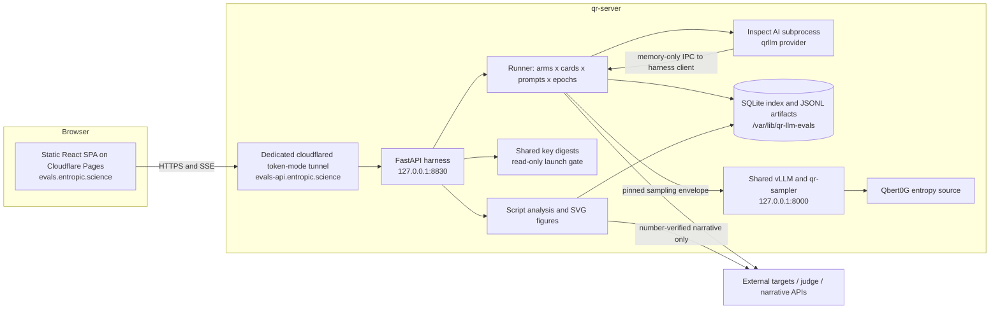

# Research harness design

This is the repository-facing design summary of approved spec v1 (2026-09-14),
D-1 through D-14. The binding task inputs remain
`.\.zenflow\tasks\plz-follow-the-following-workflo-a741\requirements.md` and
`.\.zenflow\tasks\plz-follow-the-following-workflo-a741\spec.md`.
Those task artifacts are local, not required at runtime. This tracked document preserves their system
shape and decisions; detailed API, analysis, and operator contracts live in
`.\docs\API.md`, `.\docs\ANALYSIS_PLAN.md`, and `.\docs\SETUP_GUIDE.md`.

## System shape

The browser configures, observes, and controls; the backend owns all generation
and persists progress independently of viewers. Thin and Inspect tasks share
one dispatch/provenance path. No vLLM/QRNG server is embedded in this package.
The harness calls the shared serving engine directly, not the public edge that
strips client sampling keys. External-provider arms are explicitly PRNG-only
comparisons and cannot promise the identical pinned local pipeline.

## Decision register

| Decision | Binding choice | Detail |
|---|---|---|
| D-1 | Shared vLLM on loopback `:8000` directly; edge keys gate launch only. | [Serving contract](#serving-contract) |
| D-2 | Python 3.11 FastAPI plus pnpm/TypeScript React SPA in one repository. | [Layering](#layering) |
| D-3 | Static Cloudflare Pages frontend; own cloudflared tunnel to loopback `:8830`. | [Deployment](#deployment) |
| D-4 | SQLite index plus append-only JSONL artifacts; no Postgres. | [Storage and secrets](#storage-and-secrets) |
| D-5 | Thin runner primary; custom Inspect `qrllm` provider for Inspect cards. | [Execution](#execution) |
| D-6 | Per-request derived seed `H(study_seed, card_id, prompt_id, epoch)`; study seeds 1, 7, 42. | [Equivalence](#equivalence-and-provenance) |
| D-7 | Identical stateless `zscore_mean`, calibration 0, prefetch off; creative sampling with top-p 0.95. | [Equivalence](#equivalence-and-provenance) |
| D-8 | Engine token-log Tier 0 when available; explicit degraded API-logprob path otherwise, T0-a unavailable. | [Dependencies](#serving-contract) |
| D-9 | Native Anthropic Messages judge with BYO key; OpenAI-compatible external targets via httpx, no OpenAI SDK. | [Execution](#execution) |
| D-10 | Script-generated matplotlib SVG figures and JSON tables, not LLM-generated numbers. | [Analysis](#preregistration-and-analysis) |
| D-11 | SHA-256 of exact UTF-8/LF prereg Markdown; embed canonical JSON config hash. | [Preregistration](#preregistration-and-analysis) |
| D-12 | Apache-2.0 code, CC BY-SA 4.0 docs/prereg/results prose, CC BY 4.0 raw data. | [Publication](#preregistration-and-analysis) |
| D-13 | Pseudonymous display name and random observer ID in localStorage; random host token. Observers have no accounts. People who launch runs do (amended November 2026): a username, a password and one linked api.entropic.science key, of which only the SHA-256 is stored. | [Supervision](#supervision) |
| D-14 | Run-scoped BYO keys only in process memory; restart requires key resupply. | [Secrets](#storage-and-secrets) |

## Layering

Imports point downward; `.\backend\tests\test_layering.py` is the executable
oracle. Composition roots wire adapters without upward package imports.

- **Layer 0**: config, client, keys, cards, models (restricted internal imports).
- **Layer 1**: tier0, store, prereg.
- **Layer 2**: runner, inspect_bridge, supervised; analysis has its separately
  constrained store/cards/tier0 boundary and leaf statistics functions.
- **Composition/API**: readiness, preflight, entrypoint, and API assemble the
  lower layers. No domain module imports API.

Never import `openai`, `vllm`, or `modal` anywhere under the backend. Heavy ML
libraries belong only under the lazily loaded analysis metrics area; they must
not download models or occupy serving GPUs during core startup. Package import
is side-effect free. Only `.\backend\src\qr_llm_evals\config.py` reads the
process environment, and every read has a row in `.\infra\ENV_REFERENCE.md`.

## Serving contract

The shared engine supplies chat completions, streaming, logprobs, request IDs,
per-card thinking flags, and entropy health. Qbert0G is consumed indirectly.
The key digest file belongs to qr-llm-api; group-readable access is an explicit
cross-repo operator step, with probe verification as a fallback. No raw key is
written into a run record.

**DEP-1** requests per-request token records joined by the harness request ID,
including post-truncation probability/rank, candidate count, entropy, sampled
uniform value, and CDF brackets. This export is qr-sampler work, not implemented
by harness deployment. Without usable records, raw API-logprob diagnostics are
labelled as such; T0-a and T4-l are unavailable. **DEP-2** requests epsilon-biased
seeded PRNG (`u' = u**(1+epsilon)`) as a positive control; unsupported arms stay
unavailable. Never substitute invented residuals or relabel an unsupported arm.

Readiness checks source health, envelope equivalence, solo/concurrent replay,
Tier-0 availability, epsilon support, and optionally throughput. An HTTP health
response proves neither experimental readiness nor deterministic replay.

## Equivalence and provenance

The harness owns `.\backend\src\qr_llm_evals\models\envelope.py`; browser-supplied
`qr_*` parameters are never forwarded. Study 1 compares QRNG supervised,
QRNG unsupervised, and three seeded PRNG arms, with the same model, prompts,
sampling, amplifier, and acquisition path. Derived per-request seeds prevent
restarting the same PRNG uniform stream for every prompt. The arms differ only
in entropy source, derived seed, and optional epsilon; exceptions are explicit
in cards and frozen in preregistration.

`quantum=true` requires the QRNG source and no fallback. A fallback taints a
sample; seeded, system, biased, and external provider PRNG are never labelled
quantum. Sample IDs connect generations, Tier-0 records, scoring, and resumption.
Determinism has measured tiers, not a binary promise; see `.\docs\determinism.md`.
An amplifier transform is not proof of quantum purity or observer influence.

## Execution

The runner schedules arms/cards/prompts/epochs under the global concurrency
budget, persists completed samples, and resumes without regenerating them.
Streaming feeds bounded subscriber queues; slow or absent viewers do not
change output generation. Inspect generation uses a subprocess and memory-only
IPC back to the same harness client; details in `.\docs\inspect-bridge.md`.

The registry source is `.\evals\`; `.\docs\evals.md` and generated contracts
under `.\packages\contracts\src\generated\` are machine-generated, never
hand-edited. Cards state datasets/revisions, sample counts, thinking, judge,
endpoints, estimates, and availability. Planned cards are not selectable.
Judges are fixed across arms and different from the target. External endpoints
use thin HTTP clients, never an SDK that can obscure request sampling control.

## Storage and secrets

SQLite indexes studies, runs, sessions, observers, progress, and taints; durable
JSONL and analysis artifacts live under `/var/lib/qr-llm-evals`. Release code is
separate. Data is quarantined or marked withdrawn, never deleted by deployment.
Backups must be transactionally consistent and retain artifact/index agreement.

The launch bearer key authorizes execution only. BYO target/judge/narrative keys
live in a run-scoped in-memory `SecretBag`, are filtered from logs/errors, and
are represented on disk only by presence booleans. Restart loses those keys;
`needs_keys` requires host resupply, not automatic reconstruction. Host tokens
are returned to hosts, stored hashed server-side, and not shared with observers.
See `.\docs\PRIVACY.md` for publication and consent limits.

## Supervision

Host authority controls every transition into `running`. The flow is briefing,
consent, intention (3 minutes by default), explicit Start, approximately
30-minute generation-bounded sessions, 10-minute break, 30-second refocus, and
explicit Resume. Timers may go negative and never initiate generation. Near a
session boundary, expected generation length decides whether to dispatch;
in-flight generations finish, even with modest overrun. Pseudonymous observers
join and complete pre/post questionnaires per session. Display is a viewer,
not part of sampling; breaks, presence, and intention are recorded as study data.

## Preregistration and analysis

Freeze the config, models, dataset hashes, arm envelopes, exclusions, stopping
rules, estimands, researcher expectations, and analysis plan before the full
run. Prereg Markdown uses exact UTF-8/LF bytes; canonical JSON uses sorted keys
and no non-finite values. Changing configuration makes the previous prereg stale.
Pilot data is separate; publication after a pilot is not retroactive preregistration.

Scripts implement the frozen analysis and emit tables/SVGs. The narrative model
may restate only numbers present in those tables; verification rejects invented
numbers. Multiplicity, equivalence margins, seed-vs-seed controls, positive
controls, and missing endpoints must remain visible; see `.\docs\ANALYSIS_PLAN.md`.
Results and their provenance are downloadable under the stated licences.
A null, tainted, or underpowered result must not be rewritten as a positive
consciousness claim; the empirical hypotheses do not establish metaphysics.

## Deployment

Dedicated non-login service identity; one backend process; only loopback
listening; root-owned release code; restricted writable state; separate tunnel
secret. `.\scripts\deploy.sh` archives committed bytes only, preflights before
activation, atomically flips `current`, and checks commit-specific health.
`.\scripts\rollback.sh` restores a retained compatible release without touching
data. Supervised start/resume is always manual, including after maintenance.

Cloudflare Pages publishes the static workspace build with a narrow CSP. The
separate API tunnel terminates at `127.0.0.1:8830`; no SSR, extra router, engine
installation, or database service is introduced. See `.\docs\SETUP_GUIDE.md` for
unit installation, group-read permissions, DNS, dependencies, pilot, and backup
procedures. The required development verification is `python scripts/check.py`;
live readiness and pilot are separate acceptance evidence, never implied by
passing stub tests.
